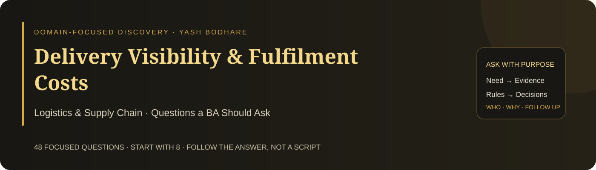

# Delivery Visibility & Fulfilment Costs

**Domain:** Logistics & Supply Chain · **48 focused questions** · **Eight suggested opening priorities**

A practical questioning guide for a Business Analyst investigating this case. Each question has a suggested stakeholder and a clear discovery purpose. Ask one question, listen, and follow the answer. The full bank is a reference—not a checklist to read in one meeting.

## 🎯 Case and decision

Customers lack reliable shipment visibility while delays and fulfilment costs rise. Discover what happens at each handoff, whether the status reflects physical progress, and which cost drivers matter. A tracking dashboard is an option, not a diagnosis.

**Decision to support:** Choose a visibility or fulfilment intervention that improves reliable delivery without hiding cost or service trade-offs.

The case trigger comes from Yash Bodhare’s portfolio card. Detailed processes, causes, obligations, targets, and systems have not been supplied. These questions help discover them; they do not assume that a particular solution or root cause has already been verified.

## 👥 People to involve

| Contact | What they can clarify |
| --- | --- |
| Logistics / fulfilment owner | Outcomes, capacity and operating priorities |
| Customers and support | Visibility needs, delivery promises and exceptions |
| Warehouse and dispatch teams | Actual flow, queues, scan and packing events |
| Carriers and delivery partners | Handoffs, transport status and contractual commitments |
| Finance and procurement | Cost drivers, fees and partner economics |
| IT, integration and security owners | Event processing, data quality, continuity and access |

These are suggested participants to confirm, not a claim about an existing organisation’s roles. Start with the accountable process owner, then follow the relevant handoffs and affected users.

## ⚡ Start here: eight opening priorities

Use these as a starting route. If the stakeholder’s answer changes the direction, adapt rather than continuing mechanically. Click an ID for the complete question below.

| Order | Question | Suggested contact | Why start here |
| --- | --- | --- | --- |
| 1 | [LS01](#ls01) | Logistics sponsor | Prioritises reliability, visibility, cost, or another need. |
| 2 | [LS02](#ls02) | Logistics / Support | Defines a meaningful service failure. |
| 3 | [LS03](#ls03) | Finance | Sets the economic boundary. |
| 4 | [LS04](#ls04) | Analytics / Logistics | Finds actionable variation. |
| 5 | [LS07](#ls07) | Warehouse / Carrier / Operations | Reveals the actual flow and waiting. |
| 6 | [LS12](#ls12) | Analytics / Finance | Prevents distorted shipment and cost denominators. |
| 7 | [LS25](#ls25) | Integration / Operations owners | Clarifies evidence behind the status. |
| 8 | [LS37](#ls37) | Logistics / Support owner | Challenges solution-first prioritisation. |

## 🧭 Question bank

### 01 · Service outcome and cost boundary

| ID | Question to ask | Ask | What it clarifies |
| --- | --- | --- | --- |
| **LS01** | Which delivery outcome should the improvement address first? | Logistics sponsor | Prioritises reliability, visibility, cost, or another need. |
| **LS02** | What does “delayed” mean relative to the customer’s promised delivery? | Logistics / Support | Defines a meaningful service failure. |
| **LS03** | Which costs are included in the reported fulfilment cost? | Finance | Sets the economic boundary. |
| **LS04** | Which shipment types, regions, or partners account for most of the deterioration? | Analytics / Logistics | Finds actionable variation. |
| **LS05** | What customer or operational harm follows inaccurate shipment status? | Customers / Support | Identifies impact of poor visibility. |
| **LS06** | What delivery commitment are we trying to preserve during the change? | Commercial / Logistics owner | Clarifies the service constraint. |

### 02 · Fulfilment flow and delay evidence

| ID | Question to ask | Ask | What it clarifies |
| --- | --- | --- | --- |
| **LS07** | Can we trace one delayed shipment across all physical handoffs? | Warehouse / Carrier / Operations | Reveals the actual flow and waiting. |
| **LS08** | Where does elapsed time accumulate before carrier collection? | Warehouse / Dispatch | Separates internal delay from transport delay. |
| **LS09** | Which handoff has the greatest mismatch between planned and actual time? | Operations / Analytics | Locates the transition to investigate. |
| **LS10** | How is the reason for a missed delivery attempt recorded? | Carrier / Support | Checks whether exception data is usable. |
| **LS11** | Which recent routing, staffing, packaging, or partner changes preceded the pattern? | Operations / Procurement | Identifies candidate causes without asserting them. |
| **LS12** | How are split shipments and repeat attempts counted in delivery reports? | Analytics / Finance | Prevents distorted shipment and cost denominators. |

### 03 · Delivery promises and exception rules

| ID | Question to ask | Ask | What it clarifies |
| --- | --- | --- | --- |
| **LS13** | Which event makes a delivery promise binding for an order? | Commercial / Process owner | Defines the promise boundary. |
| **LS14** | What conditions allow the delivery estimate to be revised? | Logistics / Policy owner | Clarifies controlled promise changes. |
| **LS15** | How are partial shipments communicated and completed? | Operations / Support | Defines a multi-parcel exception journey. |
| **LS16** | What happens when an address is incomplete or changes after dispatch? | Carrier / Support | Exposes address-correction rules. |
| **LS17** | Who decides the next step after an unsuccessful delivery attempt? | Logistics / Carrier owner | Establishes recovery authority. |
| **LS18** | What rules determine whether a parcel is resent, returned, or investigated? | Operations / Policy owner | Clarifies exceptional terminal paths. |

### 04 · Customer visibility and recovery

| ID | Question to ask | Ask | What it clarifies |
| --- | --- | --- | --- |
| **LS19** | Which shipment information helps customers decide what to do next? | Customers / Product owner | Links visibility to customer action. |
| **LS20** | Which current tracking descriptions are misunderstood? | Customers / Support | Finds language that creates unnecessary enquiries. |
| **LS21** | How should the customer be informed when no recent physical scan is available? | Support / Product owner | Avoids invented certainty about progress. |
| **LS22** | What self-service changes can a customer request without disrupting fulfilment? | Customers / Logistics owner | Explores useful action within operational limits. |
| **LS23** | Which delivery exception should trigger proactive communication? | Support / Logistics | Defines meaningful notification needs. |
| **LS24** | Who owns an enquiry when the carrier and warehouse give different statuses? | Support / Logistics owner | Establishes a cross-party resolution route. |

### 05 · Tracking data and partner integration

| ID | Question to ask | Ask | What it clarifies |
| --- | --- | --- | --- |
| **LS25** | Which source is authoritative for each shipment milestone? | Integration / Operations owners | Clarifies evidence behind the status. |
| **LS26** | How are carrier events matched to the correct parcel and order? | Integration owner | Tests identifier integrity across systems. |
| **LS27** | What happens when tracking events arrive late or out of order? | Integration / Operations | Defines timeline reconciliation. |
| **LS28** | What happens when a carrier event is duplicated? | Integration owner | Prevents duplicate state changes and messages. |
| **LS29** | How is a physical handoff recorded when scanning is unavailable? | Warehouse / Carrier | Explores continuity of reliable evidence. |
| **LS30** | Which cost records link to each shipment, return, and delivery attempt? | Finance / Data owner | Supports economic analysis at the correct grain. |

### 06 · Capacity, quality and resilience

| ID | Question to ask | Ask | What it clarifies |
| --- | --- | --- | --- |
| **LS31** | What throughput must picking, packing, and dispatch each sustain? | Warehouse / Operations | Identifies capacity requirements by stage. |
| **LS32** | Which packaging or handling errors generate rework or damage costs? | Warehouse / Quality owner | Connects quality to fulfilment economics. |
| **LS33** | What service must continue when the carrier integration is unavailable? | Operations / IT | Defines degraded-mode expectations. |
| **LS34** | Who may view customer location details or change shipment instructions? | Security / Logistics owner | Clarifies sensitive access and action authority. |
| **LS35** | Which partner, contractual, and applicable policy requirements constrain shipment handling? | Procurement / Policy owners | Requests authoritative constraints without inventing rules. |
| **LS36** | What evidence must remain available to resolve a loss or delivery dispute? | Claims / Records owner | Defines traceability and retention needs. |

### 07 · Priority, investment and partner decisions

| ID | Question to ask | Ask | What it clarifies |
| --- | --- | --- | --- |
| **LS37** | Which failure should be contained before adding a new customer dashboard? | Logistics / Support owner | Challenges solution-first prioritisation. |
| **LS38** | Which route, warehouse, or partner is suitable for a controlled pilot? | Operations / Carrier owner | Defines a feasible learning boundary. |
| **LS39** | What value would justify replacing a carrier rather than improving the handoff? | Procurement / Logistics | Compares a major option with process improvement. |
| **LS40** | Who can approve a change to delivery promises or partner arrangements? | Commercial / Logistics owner | Identifies accountable authority. |
| **LS41** | Which operating cost increase is acceptable to meet the required service outcome? | Finance / Logistics sponsor | Makes the cost-versus-reliability trade-off explicit. |
| **LS42** | What dependency could prevent the pilot from producing reliable tracking information? | Integration / Partner owner | Surfaces feasibility risks before commitment. |

### 08 · Acceptance and service-economics measures

| ID | Question to ask | Ask | What it clarifies |
| --- | --- | --- | --- |
| **LS43** | Which late, duplicated, and missing-event scenarios must be tested? | QA / Integration owner | Defines tracking-integrity coverage. |
| **LS44** | Who will validate that customer messages reflect the actual shipment evidence? | Support / Customer representatives | Checks honest and usable communication. |
| **LS45** | How will we verify that a status change matches a real operational milestone? | QA / Warehouse / Carrier | Connects display behaviour to physical evidence. |
| **LS46** | How will pilot delivery performance be compared across equivalent shipment mixes? | Analytics / Logistics | Avoids misleading aggregate improvement. |
| **LS47** | Which damage, failed-attempt, and cost measures must not worsen? | Quality / Finance / Logistics | Defines service-economic guardrails. |
| **LS48** | Who owns monitoring and resolving stale tracking after rollout? | Logistics / Support owner | Keeps ongoing accountability. |

## 🔎 Turn a vague answer into useful discovery

The examples below are practice cues, not real stakeholder statements. Ask the next question because of what you heard—not because it appears next in a list.

| Stakeholder says | Focused next question | Evidence to seek |
| --- | --- | --- |
| “The parcel is delayed.” | Delayed against which original customer promise? | Trace the agreed date, physical events, waiting, and any revised estimate. |
| “Tracking is inaccurate.” | Which displayed milestone contradicts the latest verified physical event? | Compare event identity, timestamp, arrival time, source, and parcel mapping. |
| “We need a tracking dashboard.” | Which customer or operating decision is currently blocked by missing information? | Clarify evidence freshness and recovery ownership before choosing a display. |

## 🧩 Produce only what supports a decision

- A physical-flow and status-event map, to distinguish process delay from reporting delay.
- A shipment-level cost and exception view, to identify profitable service improvements.
- A reviewed event-reconciliation and customer-message rule set, to define trustworthy visibility.

**Draft acceptance example to validate:** Given a delayed carrier event for an earlier milestone, when it arrives after a later verified event, then it does not incorrectly regress the customer-facing status. The approved event ordering and correction rules must be agreed.

This is an illustrative requirement conversation, not an approved specification or an executed test. Ask the responsible owner to confirm the rule and exceptions.

## 📊 Measures to define with stakeholders

| Candidate measure | Definition to agree |
| --- | --- |
| On-time delivery | Deliveries completed by the agreed customer promise / eligible deliveries; segment by service and shipment mix. |
| Visibility freshness | Shipments whose last reliable milestone is older than an agreed threshold, with expected scan gaps considered. |
| Service-economic guardrails | Cost per comparable shipment, repeat-attempt cost, damage, claims, and unsupported status notifications. |

Agree the population, start/stop events, denominator, baseline period, target if needed, source, and owner. A metric label alone is not a reliable measure.

## 🗣️ Close the discussion clearly

“I understand that the priority is [outcome], the current difficulty occurs at [verified step], and the key rule is [confirmed rule]. We still need [evidence or decision]. Have I captured this correctly? Who should confirm the open point, and when can we review it?”

Use this as a speaking template and populate it with what the stakeholder actually said. Record facts, interpretations, assumptions, and unresolved questions separately. Silence is not confirmation.

## 🏋️ Practise the questioning skill

1. Pick one stakeholder and a ten-minute practice window.
2. Ask one opening question without reading its purpose aloud.
3. Listen, paraphrase the answer, and ask a relevant follow-up.
4. Request an example or evidence when the answer remains vague.
5. Summarise a need, a rule, and an unresolved point—only if discovered.

Review whether your questions were neutral, specific, useful to the decision, and responsive to the previous answer. Do not measure skill by how many questions you asked. A stakeholder can genuinely not know an answer; identify who or what could verify it.

[Source and scope notes](SOURCES.md)

---

**Ask with purpose · Listen carefully · Confirm the meaning · Follow the evidence**
